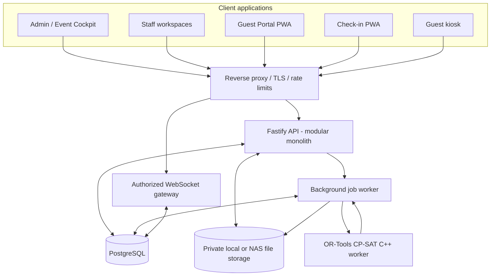
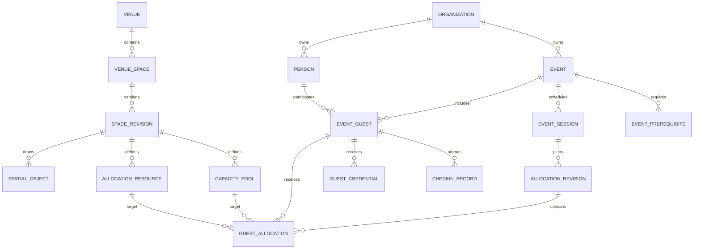

# Document control

| Item | Value |
|---|---|
| Parent baseline | Event Operations & Guest Logistics Platform Technical Blueprint v1.2 |
| Design version | 0.2 |
| Date | 10 November 2026 |
| Status | Detailed design draft; booking/configuration workstream added; not a production migration or frozen implementation contract |
| Primary reference deployment | Gazi Husrev-beg's Library (GHB), Sarajevo |
| Deployment model | Self-hosted, intranet-first, internet-capable through controlled reverse proxy |
| Primary stack | Vue 3 + TypeScript, Fastify + TypeScript, PostgreSQL, SVG, background worker, OR-Tools CP-SAT C++ worker |
| Companion artifacts | PostgreSQL schema draft, OpenAPI 3.1.1 draft, prioritized implementation backlog, GHB rental-form reference register |

## Revision history

| Version | Date | Description |
|---|---|---|
| 0.1 | 2026-11-10 | Initial detailed design: data model, spatial and allocation models, API/UI structure, repository and release gates. |
| 0.2 | 2026-11-10 | Adds configurable booking intake, versioned forms/catalogues, immutable inquiry and booking snapshots, approval workflow, resource/pricing model and GHB form reference. |

## Status and use

This package translates the v1.2 architectural blueprint into implementable design decisions. It is deliberately more specific than the blueprint, but it is still a working design. In particular, the GHB venue geometry, approved capacities, exact numbering interpretation, organizational ownership boundaries, event workflows and retention rules require confirmation with the relevant GHB representatives before production data is entered.

The companion SQL file is a **schema starter/reference**, not a ready-to-run production migration. The v0.2 booking/configuration objects extend the v0.1 core and still require a database migration review. The OpenAPI file is a first contract draft and covers the first set of core operations; it is not yet exhaustive. These artifacts must be reviewed together so the database, API and UI do not drift. Normative terms **MUST**, **SHOULD** and **MAY** are used as requirements language.

# 1. Executive implementation decisions

1. Build a **modular monolith** with explicit module boundaries, one authoritative PostgreSQL database and separate worker processes for long-running jobs and optimization.
2. Build **API-first**: every web/PWA client uses the same authenticated REST API and authorized WebSocket event stream. No client connects directly to PostgreSQL.
3. Use organization scope as the tenant boundary. The first installation can contain only GHB, but organization identifiers, authorization, files, queues, cache keys and realtime channels remain tenant-aware.
4. Separate persistent `Person` records from event-scoped `EventGuest` participation records. A person can participate in many events without carrying prior RSVP, seating or attendance state into a new event.
5. Treat venue floor plans as **versioned spatial documents**. An event session binds to a specific approved space revision; master venue edits never silently mutate an event plan.
6. Represent four different spatial concepts separately: physical feature, spatial region, allocation resource and capacity pool. Do not model every place as a chair.
7. Make allocation proposals immutable and reviewable. Automatic allocation never commits silently. Event-day changes create new revisions and preserve the previous approved/published plan.
8. Keep branding inherited and versioned: organization → venue override → event override. Generated artifacts pin the resolved brand snapshot.
9. Guest, staff and administrator views are separate data projections over the same domain model. A guest can see only their own allocation and approved public map layers.
10. CDI is an externally performed police requirement. The product records requirement, coordination, scheduling and completion confirmation only; it does not implement police inspection procedures or findings management.
11. Venue booking is a first-class module sharing the venue/resource registry but maintaining distinct inquiry, draft, offer, confirmed-booking and operational-event records.
12. Form fields, choice lists, service catalogues, prices, labels, conditional rules and organization workflows are configuration data with controlled revisions; none of the GHB choices are hardcoded application enums.
13. Retire rather than delete options that have been used. Every inquiry stores an immutable snapshot of the exact form revision, option labels and submitted answers presented at submission time.
14. Booking conversion is an explicit administrator action: an inquiry may be copied into an editable draft, revised and reviewed; only an authorized confirmation command commits the booking and reserves resources.

# 2. System context and deployment

## 2.1 Logical topology



## 2.2 Processes

| Process | Responsibility | Deployment form |
|---|---|---|
| `eogp-api` | REST API, authentication, authorization, domain commands, WebSocket authorization and read models | Linux system service |
| `eogp-worker` | Imports, PDF rendering, document/card generation, notification delivery, reports, exports and offline packages | Linux system service; concurrency-limited |
| `eogp-optimizer` | Converts an allocation problem to CP-SAT, solves it and returns a proposal plus diagnostics | Separate C++ process/service; invoked by worker |
| `eogp-web` | Compiled Vue applications; may be served by reverse proxy or API static hosting | Static files |
| PostgreSQL | Transactional state, audit, outbox and job queue | Database service |
| File store | Source workbooks, backgrounds, brand assets, generated documents and restricted attachments | Private filesystem/NAS path |

Do not introduce Redis/Valkey or microservices as a prerequisite for the first deployment. Keep job queue access behind an internal interface so a different queue can be introduced only when measurement justifies it.

## 2.3 Network zones and hostnames

Recommended logical separation (actual hostnames to be chosen during deployment):

- `manage.<domain>` – administrator and staff UI; intranet-only or VPN-protected.
- `guest.<domain>` – guest portal and public invitation/RSVP surfaces; only enabled for events that use them.
- `api.<domain>` – API routes, with public route allow-list and stricter rate limits.
- `checkin.<domain>` – check-in UI; ideally restricted to venue network/VPN, device registration and operator login.

The same deployment may use a single hostname and route-based access initially. Public exposure MUST be explicit and must not expose management routes merely because the guest portal is internet-accessible.

## 2.4 Runtime baseline

Use current supported releases selected at implementation time, pin exact versions in lockfiles and deployment manifests, and update security patch releases promptly after testing. The design baseline is Vue 3 + TypeScript + Vite, Fastify + TypeScript, PostgreSQL, Kysely or an equivalent typed SQL layer, SVG, PDF.js for PDF background display, a browser QR scanning library, and OR-Tools CP-SAT in C++.

Fastify's documented request validation and response serialization are a good fit for schema-bound routes; response schemas should be designed to prevent accidental disclosure of fields. Vue's official TypeScript support supports strict typing across client components. OpenAPI 3.1.1 is selected for broad tooling compatibility in this first contract draft, even though newer OAS patch/minor versions exist. CP-SAT uses integer constraints/objectives and exposes solver statuses such as OPTIMAL, FEASIBLE, INFEASIBLE and UNKNOWN; the API must preserve these distinctions rather than presenting every non-error as success. References are listed in Section 19.

# 3. Domain boundaries and core identifiers

## 3.1 Primary identifiers

All internal entity identifiers are UUIDs. Human-readable identifiers are separate, organization-scoped or event-scoped codes. Guest-facing credential tokens are random, opaque, high-entropy values whose hashes are stored server-side.

| Identifier | Example | Meaning |
|---|---|---|
| Organization ID | UUID | Tenant boundary |
| Person ID | UUID / `P-000123` display code | Persistent human identity in an organization |
| Event Guest ID | UUID / `EG-2027-0042` | Person's participation in one event |
| Event ID | UUID / `EV-2027-001` | Event aggregate |
| Session ID | UUID | One timed programme/session within an event |
| Venue Space Revision ID | UUID | Immutable approved room/space configuration |
| Spatial Object ID | UUID | Floor-plan object, region, feature or label |
| Allocation Resource ID | UUID | An assignable seat, floor position or row/segment |
| Allocation Revision ID | UUID | Immutable set of assignments for a session |
| Credential ID | UUID | One issuance/reissue of a QR credential |

## 3.2 Person versus event participation

`persons` stores relatively stable identity/profile information. `event_guests` stores the event-specific participation: event category, RSVP, guest code, group assignment, attendance state, event notes, approved display data and allocation. Event data is snapshotted at defined lifecycle points. Updating a master profile must not rewrite a published pass, an old event record or historical reports.

A person may appear at most once as a primary event guest per event in the standard flow. Multiple participation records for the same person are allowed only where an explicit event workflow requires different roles/attendance units; that is a product decision requiring a distinct participation type, not an accidental duplicate.

# 4. Relational data model

The companion `eogp_schema_v0.2.sql` contains the first PostgreSQL DDL draft (64 core table definitions plus 22 v0.2 booking/configuration table definitions at this design revision). The following summarizes the intended table groups and constraints. It includes primary/foreign keys, tenant identifiers, unique constraints, indexes and representative lifecycle/check constraints; triggers, full RLS policy rollout, retention partitions and production seed data remain implementation tasks.

Core relationship map (simplified; the SQL file is authoritative for the draft keys):



## 4.1 Organization, users and authorization

- `organizations`: tenant root, slug, legal/display name, timezone, locale and lifecycle status.
- `users`: login identity, password hash or external identity reference, account state and MFA configuration.
- `organization_memberships`: link a user to an organization.
- `roles`, `permissions`, `role_permissions`, `user_role_grants`: permission bundles and explicit scope (organization, event, venue, space or station).

Do not treat a platform administrator as automatically authorized to read confidential guest notes. Technical administration and operational-data access are separate permissions.

## 4.2 Branding and templates

- `brand_profiles`: one profile attached to an organization, venue or event override.
- `brand_profile_revisions`: immutable token/asset configuration snapshots.
- `brand_assets`: logos, graphic motifs, backgrounds, font assets (where licensing permits), signatures and approved media.
- `document_templates` and `document_template_revisions`: invitations, guest cards, QR passes, plans, signage and reports.
- `event_brand_snapshots`: resolved organization/venue/event inheritance captured for an event or artifact batch.

Inheritance precedence: event override → venue override → organization profile → platform default. User display preferences do not alter event or document branding. Every generated document records its template revision and brand snapshot revision.

## 4.3 Guest Registry and event membership

- `persons`, `person_contact_points`, `person_identifiers`: reusable profile, multiple contacts and optional external references.
- `guest_categories`: organization-defined categories, with event overrides where needed.
- `event_guests`: a person participating in an event.
- `guest_groups`, `guest_group_members`: event or organization groups, delegations, families and parties.
- `guest_relationships`: relationship semantics such as together, prefer-together, keep-apart, assistant/principal or family; an event-scoped override can supersede the reusable relationship.
- `guest_notes`: separately classified and permission-controlled.
- `guest_custom_field_definitions` and `guest_custom_field_values`: governed extensibility. Avoid an untyped “everything in JSON” profile.
- `guest_import_batches` and `guest_import_rows`: field mapping, duplicate candidates, validation errors and merge decisions.

Deduplication must be assisted, never a destructive fuzzy merge. Candidate matching can use normalized email/telephone/name and organization as signals; an authorized reviewer confirms merges. Keep a merge audit and aliases/identifiers for former records.

## 4.4 Event and sessions

- `events`: name, code, type, timezone, start/end, lifecycle state, organization and resolved brand.
- `event_sessions`: timed programme elements, each bound to one or more specific venue-space revisions through `event_session_spaces`.
- `event_status_history`: state transition record.
- `event_settings`: portal, check-in, notification, allocation and readiness policies.

An event can use multiple rooms at once and can move guests between spaces over multiple sessions. Seating/allocation is scoped to a session, not just the event.

## 4.5 Venue and spatial schema

- `venues` → `venue_buildings` → `venue_levels` → `venue_spaces`.
- `venue_space_revisions`: immutable versions of a room configuration.
- `floor_plan_assets`: background SVG/PDF/image or source-render asset.
- `spatial_layers`: background, zones, features, resources, labels, public map, staff-only overlays.
- `spatial_objects`: points, lines, polylines, polygons, rectangles, circles and symbols with a typed role and JSON geometry.
- `allocation_resources`: individually or group-assignable objects such as seats, floor positions and row segments.
- `capacity_pools`: count-only capacities for zones or standing areas.
- `source_plan_artifacts` and `source_plan_mappings`: immutable Excel/PDF/image source and reviewer-approved mappings to native objects.

A feature, region, resource and pool are not interchangeable. A pillar is a feature; a blue zone is a region; a numbered floor position is a resource; a zone-only capacity allowance is a pool.

## 4.6 Allocation, revisions and publication

- `allocation_rules`: typed rule with severity, scope, weight and configuration.
- `allocation_runs`: solver run, input revision, solver version, status and diagnostics.
- `allocation_revisions`: draft/proposed/approved/published/superseded revision.
- `guest_allocations`: one event guest's placement in a session and revision, targeting either one resource or one capacity pool.
- `allocation_locks`: locks on guest, group, resource, row or region at a specific revision/workspace.
- `allocation_change_records`: reason, actor, before/after and source command.
- `plan_approvals`, `plan_publications`: explicit approval and distribution record.

Only an allocation revision may be committed after server-side validation. The solver's result is a proposal, not an authoritative placement. For commit, the API locks the session's current revision row and affected capacity/resource rows, verifies the expected revision, recomputes occupancy against the full resulting assignment, applies uniqueness/capacity checks, writes the new revision and audit/outbox entries, then commits. Do not hold a transaction open while the solver runs. Resource exclusivity should also be reinforced by database constraints where the resource capacity is one; row-segment and capacity-pool occupancy is enforced inside the locked commit transaction.

## 4.7 Credentials, check-in and prerequisite tracking

- `guest_credentials`: hashed token, event guest, scope/session, issued/revoked/expiry state and replacement chain.
- `checkin_stations`: registered scanner or kiosk device.
- `checkin_records`: append-only attendance events with idempotency key, operator, station and timestamp.
- `checkin_corrections`: compensating action; never rewrite the original scan record.
- `event_prerequisites`: CDI or other external task, responsibility, request/schedule/completion state and optional readiness-gate flag.
- `prerequisite_status_history`: immutable status transitions.

CDI records only the fact that the responsible police authority is expected to perform or has performed the task, plus administrative coordination details and a completion confirmation by an authorized internal user. No internal CDI methodology or findings records are in scope.

## 4.8 Operational data

- `operational_alerts`: actionable event exceptions with severity, owner, status and resolution.
- `operational_issues`: manually raised event-day issue records.
- `audit_events`: immutable security/business audit entries.
- `outbox_events`: transactional outbox for WebSocket delivery and downstream jobs.
- `background_jobs`: imports, rendering, solver runs, exports and notifications.
- `generated_documents`: output metadata, immutable storage key, template revision and brand snapshot.

## 4.9 Configurable catalogues, booking forms and booking records

The application MUST NOT hardcode organization-specific choice lists such as GHB room choices, event types, audio configurations, projection methods, rehearsal choices or refreshment arrangements into TypeScript enums or SQL `CHECK` constraints. These are administrator-managed configuration records. System lifecycle states and security-critical invariants may remain controlled enums; organization business choices must be data-driven.

**Catalogue model:** `config_catalogues` defines a named list within an organization and optional venue/space scope. `config_catalogue_options` is the stable identity of a choice (`code` never changes after publication). `config_catalogue_revisions` and `config_catalogue_option_revisions` preserve labels, translated labels, descriptions, sort order, availability, metadata and optional links to actual service/resource definitions. A catalogue revision is drafted, reviewed and published. Published revisions are immutable.

- Add a choice by creating a new stable option identity and including it in a new catalogue revision.
- Remove a choice from future forms by omitting it from the next published revision and marking the stable option retired. Do not delete it if any inquiry, draft, offer or booking references it.
- Change spelling/translation/help text without changing meaning by creating a new option revision while retaining the stable option identity.
- Change the meaning, price basis or fulfilment semantics by retiring the old option and creating a new stable option identity. Do not silently reinterpret historic submissions.
- Reorder choices through revision metadata; do not encode business meaning in display order.
- Scope catalogues to organization, venue, space or event where required. A venue-specific value can override an organization default only through an explicit resolved form configuration.

**Form model:** `booking_form_definitions` identifies a reusable form (for example, GHB hall rental inquiry). `booking_form_revisions` contains a versioned schema, locale support, layout and conditional rules. Fields use stable `field_key` values and declared control types (text, textarea, email, telephone, number, date, time, date-time, select-one, select-many, checkbox group, radio group, file upload, informational text). A field can bind to a catalogue revision instead of carrying hardcoded options. A published form revision pins the catalogue revisions it uses.

Conditional behavior is a declarative, allow-listed rule format, evaluated on both client and server. Examples: show the rehearsal date/time fields when rehearsal is requested; show refreshment location and item choices only when refreshments are requested; require quantity only for a GHB-provided refreshment arrangement. Arbitrary JavaScript, SQL, expressions or executable templates MUST NOT be accepted as form rules. The server is authoritative for visibility, validation and requiredness. Hidden fields are not trusted merely because the browser omits them.

**Inquiry, draft and booking records:** `booking_inquiries` preserve the original public submission and the exact published form/catalogue snapshot used to collect it. They are append-only from the normal administration UI; corrections are recorded as annotations or follow-up messages, not edits to the submitted payload. `booking_drafts` are separate working records created manually or from an inquiry. Each edit creates a `booking_draft_revision` with actor, timestamp, reason and a structured snapshot. Requested, approved and delivered values are kept separately for service/resource lines. Offers pin a draft revision and pricing revision. `booking_records` are created only by an authorized confirmation command and preserve the confirmed snapshot, source draft revision, accepted terms and resource reservations. An operational `event` is optional and may be created/linked later; not every room booking needs guest management or check-in.

**Historical stability:** changing a catalogue or form affects future submissions only. Open inquiries remain readable under their original submission snapshot. An administrator may explicitly create a migrated working draft using a newer form/catalogue version, but must review the mapped values and retain the original inquiry unchanged. Confirmed bookings and issued quotations never recalculate silently when a price list changes.

## 4.10 Booking resource and pricing separation

A visitor's form selection expresses a **request**, not an automatically approved service or a confirmed charge. For example, `U aranžmanu GHB` means that the organizer requests GHB-arranged refreshments. It does not, by itself, create a catering order, guarantee availability or calculate a final price. Staff map requested values to approved resource/service lines during draft review.

Maintain distinct concepts:

- **Venue/space resources:** rooms, associated rooms, buffet/foyer areas and other reservable spaces.
- **Equipment resources:** microphones, projectors, screens, interpretation/streaming equipment and other inventory.
- **Services:** rehearsal support, technical support, additional personnel, cloakroom and catering arrangements.
- **Form choices:** language presented to the visitor; these can map to one or more resource/service catalogue entries but are not themselves inventory or price records.
- **Price lists and rules:** versioned amount, currency, duration band, tax basis, effective dates, discount/surcharge applicability and approval rules.

Booking lines preserve `requested`, `approved` and `delivered` values/quantities separately. A line may be included, chargeable, subject to availability, manually quoted or pending approval. Pricing is calculated from a pinned price-list revision. Manual adjustments require reason and permission. A quote is immutable once issued; revisions create a replacement offer rather than rewriting the old one.

Rehearsal, setup and dismantling are separate scheduled time blocks linked to the primary booking. Availability checks cover the whole interval including configurable buffers, not only the public event start/end. Shared equipment and personnel may have their own calendars and conflicts. A booking confirmation is atomic: all required space/resource reservations are validated and committed together or none are committed.

# 5. Spatial model and floor-plan editor

## 5.1 Coordinate and geometry standard

Use a local two-dimensional coordinate space per `venue_space_revision`, not latitude/longitude. The native SVG viewBox is the canonical editor coordinate system. Recommended default: width/height of 10,000 logical units, with optional physical width/height in millimetres for scale-aware printing. Store transforms as explicit affine transforms. Never derive real-world physical dimensions solely from spreadsheet cell dimensions or a screenshot.

Example geometry JSON:

```json
{
  "type": "polygon",
  "coordinates": [[120, 100], [4200, 100], [4200, 3900], [120, 3900]],
  "unit": "viewbox",
  "rotation": 0
}
```

The browser renders native objects as SVG. Geometry edits are stored as commands/patches and saved through optimistic concurrency against the space revision. Snap-to-grid and alignment aids are editor features, not a requirement that objects occupy spreadsheet cells.

## 5.2 Object taxonomy

| Kind | Examples | Assignable? |
|---|---|---|
| `space_boundary` | Room outline | No |
| `region` | Red/blue/green zone, reserved area, VIP area | No; may own capacity pool |
| `feature` | Pillar, minber, stage, entrance, wall, footwear area, passage | No |
| `row` | Theatre row, prayer row | Sometimes, if the chosen mode is row/segment |
| `row_segment` | Subsection of a row | Yes, with capacity or position range |
| `table` | Banquet table | Usually parent/container, not itself a seat |
| `seat` | Chair or fixed theatre seat | Yes, capacity 1 |
| `floor_position` | Numbered prayer/carpet position | Yes, capacity 1; does not imply a chair |
| `capacity_pool` | Zone-only or standing capacity | Yes, many guests up to approved limit |
| `label` | Text, compass, legend, locator | No |
| `path` | Public/staff navigation route | No; visibility-controlled |

A spatial object may have a `public`, `staff`, `management` or `restricted` visibility classification. The guest projection is generated from explicitly published layers, not from client-side filtering of the complete map.

## 5.3 GHB workbook: first import profile

The supplied workbook is one worksheet (`Sheet1`) with a used range `A1:BB34`, formatted as a drawing using cell borders, fills, merged/positioned labels and numbers. It is not a structured guest list or a clean tabular seat inventory.

Observed labels and annotations:

| Source annotation | Proposed native representation | Validation status |
|---|---|---|
| `CRVENA ZONA = 74` | Red region; proposed capacity annotation 74 | Unconfirmed |
| `ZELENA ZONA = 150` | Green region; proposed capacity annotation 150 | Unconfirmed |
| `PLAVA ZONA = 140` | Blue region; proposed capacity annotation 140 | Unconfirmed |
| `MAHFIL DONJI = 14` | Named special region/resource group | Unconfirmed; overlap with colour-zone counts to be checked |
| `MAHFIL GORNJI = 10` | Named special region/resource group | Unconfirmed |
| `MAKSURA LIJEVA = 10` | Named special region/resource group | Unconfirmed |
| `MAKSURA DESNA = 10` | Named special region/resource group | Unconfirmed |
| `MINBER` | Non-allocatable feature/landmark | Confirm location/type |
| `STUB` | Obstacle/column feature | Confirm each instance |
| `STUB I PROLAZ` | Feature and passage region, potentially separate objects | Confirm exact geometry |
| `ULAZ` | Entrance feature and route origin | Confirm guest/staff use |
| `OBUĆA` | Footwear area/landmark | Confirm public visibility |
| `ćurs`, `HOR`, `Sat`, `Stub` and other small labels | Source labels retained for human review | Semantics unresolved |
| Repeated number sequences | Position labels scoped by row/zone/block | Must not be treated as global IDs |

The workbook render shows three large colour-coded regions and multiple rows/blocks, alongside special areas and fixed features. The numbers repeat in multiple local sequences. The software MUST NOT sum all annotated values, infer overlapping capacities, or assume each number cell is an independently usable position.


The render is provided for engineering context only. The original XLSX remains the source artifact; neither the screenshot nor extracted cell values constitute an approved venue plan.

## 5.4 Spreadsheet onboarding workflow

1. Upload the original workbook as a private immutable source artifact; calculate SHA-256 and record uploader/time.
2. Render selected sheet(s) using a controlled conversion adapter. Preserve original bytes; keep rendered preview linked to source hash.
3. Create a new draft `venue_space_revision`; import the rendered sheet as a locked background layer.
4. Record orientation, crop and optional known physical measurement.
5. Trace room/area boundaries, zones, special areas, non-allocatable features, entrances and passageways.
6. Add rows/row segments and numbered positions only where venue staff confirm that individual position assignment is appropriate.
7. Capture numbering scope and original label. Example scoped locator: `BLUE / ROW 04 / POSITION 12`.
8. Capture each source-to-native relation, including source sheet and cell/range/visual region where practical.
9. Compare source and native reconstruction side by side; resolve ambiguous labels and possible overlapping regions.
10. Enter proposed capacity annotations as provisional. A venue-authorized reviewer confirms approved values and whether special areas are included in other counts.
11. Approve the venue-space revision. The approved revision becomes selectable for event sessions.

For v1, use a renderer adapter so the application is not coupled to one office conversion product. The onboarding flow may accept a companion PDF/PNG if a server-side XLSX renderer is unavailable or does not reproduce the workbook faithfully. Automatic OCR/number extraction is advisory only.

## 5.5 Editor screens and interactions

**Venue registry:** venue tree, buildings, levels, spaces, active template revision, status and brand override.

**Space editor:** left object palette; central SVG canvas; right properties inspector; top undo/redo, zoom, snap, layers, save and validation; bottom revision state/source reference. Support select/multi-select, draw rectangle/polygon/line, add symbol, rotate, resize, group, duplicate, align, lock, hide, layer ordering and undo/redo.

**Resource editor:** create row/seat/floor-position numbering schemes, set parent scope, import labels, generate sequential labels, validate duplicates and show capacity counts. Re-numbering creates a revision; existing event allocations remain pinned to old revision.

**Validation panel:** overlapping allocatable resources, resources outside parent region, duplicate scoped numbers, unapproved capacities, missing entrance, invalid route topology, hidden required labels and source mappings without review.

# 6. Event allocation engine

## 6.1 Inputs and outputs

Inputs are: session, eligible event guests, candidate resources/capacity pools, hard constraints, soft preferences, locked assignments, scope to reflow, current allocation revision and optimization policy. Output is a proposed allocation revision plus diagnostics and a diff against the current revision.

A run must be reproducible: persist solver build/version, normalized input payload hash, parameters, random seed where applicable, start/end time, status, objective values, diagnostics and proposed assignment set.

## 6.2 Assignment variables

For a session with guest set `G` and candidate target set `R`, define binary variable:

`x[g,r] = 1` when guest `g` is assigned to target `r`; otherwise 0.

A target is either an individual allocation resource or a capacity pool. A target has a typed allocation granularity: seat, floor position, row/segment, or zone capacity. The model builder expands only legal guest-target combinations.

## 6.3 Core hard constraints

1. **Single placement:** each guest gets exactly one placement when required; optional guests may remain unassigned only if the run policy explicitly allows it.
2. **Resource exclusivity:** capacity-one resources accept at most one guest.
3. **Capacity:** sum of occupants assigned to a row segment/pool cannot exceed its approved capacity minus reserved capacity.
4. **Eligibility:** guest category, access requirement, event state and resource restrictions are respected.
5. **Separation:** guests in an active `must_not_share` relation cannot share the configured scope.
6. **Locked placements:** assignment locks remain unchanged unless the command explicitly requests authorized unlock.
7. **Session consistency:** a guest cannot be allocated to simultaneously overlapping sessions in physically conflicting locations unless an explicit transition rule allows it.
8. **Resource availability:** closed, reserved, restricted or superseded resources cannot be selected.
9. **Tenant/event integrity:** a guest, session and resource must belong to the same organization and compatible event/venue scope.

## 6.4 Separation-rule semantics

A separation rule needs a scope, not just a generic “keep apart” checkbox.

| Scope | Meaning |
|---|---|
| Same table | Must not share the same table |
| Same row/segment | Must not be assigned within the same row or segment |
| Same zone | Must be allocated to different zones |
| Same room | Must not occupy the same room/space in that session |
| Same building | Must be in different buildings |
| Minimum distance | Their target geometries must be at least configured distance apart, using the native map coordinate scale |
| Different sessions | Must not overlap in a session or time window |

Rules can be defined between individual people, groups, categories or dynamic filters. Dynamic rules are evaluated into a run snapshot. A change in the master group after a solver run does not retroactively change that proposal.

If two guests must not share the same zone, the model prohibits assigning them to targets whose ancestor zone is the same. For each forbidden pair `(a,b)` and each zone `z`, add:

`sum(x[a,r] for r in targets_in_zone(z)) + sum(x[b,r] for r in targets_in_zone(z)) <= 1`.

The same pattern applies to tables, rows, rooms and buildings. For distance rules, only precomputed eligible target pairs closer than the minimum are forbidden together; exact pairwise distances must be computed from geometry at proposal-build time and included in the run diagnostics.

## 6.5 Soft preferences and objective

Soft preferences may include togetherness, group cohesion, preferred zones, VIP priority placement, category distribution, preferred proximity to stage/entrance, balanced fill and minimal changes from current plan. Weights are integer-scaled; avoid arbitrary floating-point penalties.

Do not make demographic balancing an unconditional default. If an organization configures an attribute-based balancing rule, it must define the field, lawful/approved use, scope, weight, visibility and retention. A guest's personal profile should not be used as a solver feature merely because the field exists.

Use a staged/lexicographic objective:

1. Satisfy all hard constraints.
2. Minimize authorized unassigned guests / capacity waste where policy permits.
3. Minimize high-priority soft-rule violations.
4. Minimize lower-priority soft-rule violations.
5. Minimize disruption from the current revision during targeted live reflow.

For live reflow, preservation of unaffected assignments is an explicit objective or hard lock, according to the command. A “reflow selected zone” operation must not move unrelated guests unless the administrator enables cross-zone displacement and is shown that scope in the preview.

## 6.6 Solver states

- `OPTIMAL`: best proven solution for the configured model/objective.
- `FEASIBLE`: valid solution found but optimality not proven within limits.
- `INFEASIBLE`: no solution exists under current hard constraints.
- `MODEL_INVALID`: model construction/validation defect; do not show as a normal planning outcome.
- `UNKNOWN` / timeout: no conclusive result; preserve the existing plan.

Only OPTIMAL or FEASIBLE proposals may be previewed as valid arrangements. Neither may be committed until application-side validation succeeds. INFEASIBLE should show actionable diagnostics: conflicting rules, locked placements, insufficient capacity, or impossible group constraints where the solver can explain them.

## 6.7 Targeted reflow workflow

1. Administrator selects one or more guests, groups, rows, tables, zones or spaces.
2. UI displays the proposed reflow boundary and whether adjacent zones may be used.
3. API creates a run against the current revision number.
4. Solver receives affected guests plus candidate resources and fixed placements for all unaffected/locked guests.
5. Solver returns a proposal and diagnostics.
6. UI compares before/after allocations and highlights moved, unchanged, unassigned and newly occupied positions.
7. Administrator accepts all or a permitted subset; subset acceptance triggers a validation run against the resulting full assignment.
8. Commit checks that current revision still equals source revision. If stale, reject with `409 REVISION_CONFLICT` and require refresh/re-run.
9. Commit creates a new draft/live revision and a change record with reason. If event policy requires approval, it remains unpublished pending authorized approval.
10. Publication updates staff/guest projections, invalidates obsolete output status and queues notifications according to policy.

## 6.8 Manual assignment and drag/drop

Manual assignment uses the same validation service as solver commit. Dragging a guest to a seat is not authoritative until server acceptance. If invalid, restore the visual position and display the conflicting rule/capacity message. Multi-select and group moves must be transactional.

# 7. Venue booking and inquiry management

## 7.1 Purpose and boundary

The booking module accepts public venue inquiries and manages them internally through review, draft preparation, offer/approval and confirmed reservation. It shares organization branding, venue hierarchy, space/resource catalogue, availability services, notifications, document templates and audit infrastructure with the event platform. It is not a separate application or plugin.

A public inquiry is not a reservation. A draft is not a confirmation. A confirmed venue booking is not automatically an operational event. These are separate records and separate lifecycle transitions.

## 7.2 Visitor-facing inquiry

The public portal renders a published form revision for the selected organization and booking type. It can be branded with the organization/venue profile and localized. No visitor account is required for the initial inquiry. The public form can collect organizer/institution, contact person, telephone, email, requested venue, preferred date/time, event type, expected attendance, requested duration, audio/projection choices, special requirements, rehearsal, cloakroom personnel, refreshment arrangement/location/items/quantity, attachments and notes. The exact fields are configurable and not mandatory for every organization or venue.

The form builder supports single-select, multi-select and checkbox groups. A choice may simply add a value to the request; it does not imply approval, fulfillment or pricing. Optional enhanced behaviors include date/time pickers, attendee estimates, availability hints, room-specific equipment display, dynamic rehearsal date/time, conditional refreshment quantity and conditional attachment questions. Organizations decide which of these are enabled.

The public endpoint MUST validate server-side, apply rate limits and abuse controls, restrict upload types/size, scan or quarantine files according to deployment policy, protect against CSRF where cookie context exists, and avoid disclosing internal booking calendar details. Public availability may expose only requestable/unavailable/high-level status.

## 7.3 Configurable choice catalogues and form builder

Authorized administrators manage choice lists and form definitions through a visual configuration interface. No code deployment is required for ordinary changes to fields or options.

The form builder must support:

- Add, remove from future versions, rename, translate, reorder and group fields/options.
- Field types: text, long text, email, telephone, integer/decimal, date, time, date-time, select-one, select-many, radio, checkbox, checkbox group, file upload and display-only content.
- Per-field label, help text, placeholder, default, visibility, requiredness, validation constraints and PII classification.
- Bind an option field to a versioned catalogue; allow static form-local options only for genuinely one-off presentation choices.
- Declarative show/hide/enable/require/set-default rules with AND/OR condition groups and a bounded operator/value vocabulary.
- Conditional fields and requirements; server-side evaluation must exactly match client-side behavior.
- Organization, venue and form-type scope; translations; preview/test mode; draft/publish/retire and revision history.
- Preview old and new revisions side by side and inspect which future forms will be affected.

Do not use executable JavaScript snippets or arbitrary expressions in admin-configured rules. Publish only schema-valid definitions. If a field or option is removed, past submissions remain fully readable.

### Option change policy

| Administrator action | Required system behavior |
|---|---|
| Add option | Create stable option code/ID; include it in a new catalogue revision; publish revision. |
| Rename or translate | Create a new option-label revision; keep stable semantic option identity if meaning is unchanged. |
| Change meaning | Retire the old option and create a new option identity. |
| Remove option | Omit from future published catalogue/form revision and retire; preserve historic references. |
| Reorder/group | Publish a new revision with new sort/group metadata. |
| Change field type/key | Create a new form revision; run compatibility/migration checks; never silently coerce historic answers. |
| Change conditional rule | Publish a new form revision and run automated scenario tests before activation. |
| Change price | Publish a new effective-dated price-list revision; existing offers/bookings retain their pinned price snapshot. |

Draft edits are not visible publicly until published. Only one active published revision per form/locale/channel should be selected for new submissions at a time, with an explicit rollback operation to a previous revision. Rollback creates a new publication event referencing an earlier immutable revision; it does not rewrite history.

## 7.4 GHB reference form profile

The browser-extracted GHB rental form is a **reference seed**, not an enforced global schema. Its visible fields and captured choices are recorded in `GHB_Rental_Form_Reference_v0.2.csv`. The register records exact labels/options captured on 10 November 2026 and explicitly distinguishes markup observations from confirmed business rules.

The observed request fields include organizer/institution, contact person, phone, email, hall, event start, event type, duration, basic audio, additional audio, projector, projection control, special requirements, rehearsal, additional cloakroom personnel, refreshment arrangement, refreshment location, refreshment headcount, refreshment types and notes. Captured choices include the three hall choices; event type choices (book promotion, lecture, seminar, round table, conference, anniversary, other); duration choices (up to two/four/eight hours); audio/projector/projection-control configurations; special requirements (simultaneous interpretation, hybrid online conference, exhibition, registration tables); yes/no rehearsal and cloakroom choices; refreshment arrangement and serving-location choices; and four refreshment checkboxes (coffee/tea, water, juices, sweets).

The extract shows the HTML `required` property as false for the captured controls and the initial-state visibility as true. This does **not** prove the site's server-side validation or dynamic behavior. Conditional reveal rules were not conclusively observed. Treat all captured options as editable seed data pending GHB confirmation. The public venue choices currently captured are three halls; the mosque must not be added to rental options merely because it exists in the venue registry.

## 7.5 Inquiry-to-booking lifecycle

1. **Inquiry submitted:** store original payload and immutable form/choice/label snapshot; issue public reference and receipt.
2. **Triage:** internal user assigns owner, reviews the request, checks the calendar and requested facilities; may request clarification, mark not suitable, reject or begin draft preparation.
3. **Create draft:** copy the submitted values into a separate draft. Preserve a source link to the inquiry. Do not modify the inquiry record.
4. **Draft revision:** administrator adjusts venue, times, setup/teardown, rehearsal, resources, staffing, catering, equipment, attendee estimates, pricing and internal notes. Changes are versioned and diffable against both original inquiry and prior draft.
5. **Offer/approval (optional per organization):** issue an immutable offer from a specific draft revision; require internal approvals and/or organizer acceptance if configured.
6. **Confirm booking:** an explicitly authorized command validates current draft revision, venue/resource availability, required approvals, offer state and any readiness rules; commits reservations atomically; creates the confirmed booking snapshot and sends confirmation.
7. **Event conversion (optional):** create/link an operational event and sessions when guest management, invitations, seating, QR, check-in or cockpit workflows are needed. The booking remains the commercial/resource reservation record.

Manual booking creation without public inquiry is supported. Rejection, withdrawal, expiry, cancellation and rescheduling are explicit audited transitions. Confirmed booking changes create a new booking revision/change order or controlled amendment; they do not overwrite the original confirmed snapshot.

## 7.6 Requested, approved and delivered values

For each resource/service line, store separately:

- `requested`: what the visitor asked for.
- `approved`: what the organization agreed to provide.
- `delivered`: what was actually supplied, if the organization tracks fulfillment.

A request like “refreshments in GHB arrangement” remains a requested value until staff decide the actual items, headcount, serving location, staffing and pricing. The same principle applies to microphones, rehearsal, projection, cloakroom and special arrangements. Do not infer a charge merely from a visitor's selection.

## 7.7 Availability and scheduling

Availability must account for the entire occupied interval: setup, rehearsal, event, dismantling and configurable buffer. The engine checks venue spaces, linked/ancillary spaces, shared equipment and personnel separately. Configurable resource dependencies (for example, an add-on room offered only with a primary room) are data-driven.

Requests may be submitted even when the public calendar hides exact internal details. The system can respond with request received / needs review rather than exposing another organizer's booking. Internal users see full conflict details according to permissions.

A tentative hold is temporary, scoped to a set of resources and time interval, has an explicit expiry, and does not imply confirmation. Confirmation uses a transaction that locks the relevant resources/time windows, rechecks conflicts and commits all reservations atomically. Concurrent requests must not double-book a resource.

## 7.8 Pricing, offers and policy versions

The pricing engine is configurable, effective-dated and organization/venue scoped. It supports fixed charges, duration bands, hourly rates, packages, add-ons, quantity-based services, weekend/holiday adjustments, discounts, surcharges, negotiated/manual lines, tax-inclusive or tax-exclusive presentation and currencies. Rules are published as immutable revisions. Quotes and confirmed bookings pin the applicable price and policy snapshot.

The engine may calculate an indicative estimate for staff; public price display is optional. A quote must clearly label estimated versus approved amounts, currency, tax basis, validity, included/excluded services, discounts and manual adjustments. Historical GHB pricing/protocol documents are reference material only until GHB confirms their current validity.

## 7.9 Booking administration screens

- Inquiry inbox: filters, owner, dates, venue, event type, status, urgency and duplicate detection.
- Inquiry detail: immutable original submission, captured form revision, attachments, contact and communication timeline.
- Create draft: one action copies the request into an editable draft.
- Draft editor: original-versus-proposed comparison, requested/approved/delivered service lines, calendar conflicts, rehearsal/setup/teardown intervals, internal notes and revision history.
- Resource calendar: space, equipment and personnel calendars with tentative holds and confirmed reservations.
- Offer/approval: price breakdown, document preview, approval chain, expiry and acceptance state.
- Confirmation: validation summary, atomic resource commit and generated confirmation.
- Configuration studio: catalogues, option lists, form fields, conditional rules, translations, revisions, previews and publication/rollback.
- Booking analytics: inquiry conversion, utilization, cancellations, lead time, revenue where applicable and resource utilization.

## 7.10 Booking security and public exposure

Expose only explicitly allow-listed public endpoints through the reverse proxy. Administration, catalogue editing, inquiry review, pricing, internal availability and approval endpoints remain authenticated and role-protected. Public form definitions contain only public labels and allowed choices; never return internal notes, booking identities, prices not approved for publication or security-sensitive venue layers.

Public submissions require abuse controls (rate limit, honeypot and/or challenge, input validation, upload restrictions and idempotency/duplicate handling). Email addresses and phone numbers are personal data; classification, access, exports, retention and deletion rules apply. Public tracking should use a separate high-entropy reference token and must not expose inquiry enumeration.

# 8. API contract design

## 8.1 Contract principles

- Prefix: `/api/v1`.
- JSON over HTTPS; OpenAPI 3.1.1 contract is in `eogp_openapi_v0.2.yaml`.
- Authenticated administration uses secure, HttpOnly, SameSite cookies or a validated OIDC session; avoid storing long-lived bearer tokens in local storage.
- Guest access uses a separate short-lived/scope-limited token, not staff session cookies.
- Every API response includes `requestId`; errors use a common envelope.
- Standard status mapping: 400 malformed/invalid request; 401 missing/invalid authentication; 403 authenticated but not permitted; 404 absent or outside authorized scope; 409 state/uniqueness/revision conflict; 412 stale ETag; 422 valid syntax but domain rule violation; 429 rate limit; 503 required worker/dependency unavailable. Error bodies must not disclose restricted PII or whether a cross-tenant record exists.
- List routes use cursor pagination (`limit`, `cursor`) and stable sort order.
- Mutating commands that can be retried use `Idempotency-Key`.
- Revision-sensitive writes use `If-Match` / `ETag` or an explicit `expectedRevision`.
- Use `application/problem+json`-style error semantics, consistently implemented.
- Fastify request schemas validate input; response schemas whitelist output properties.
- OpenAPI contract and shared TypeScript types are generated/validated in CI; avoid separately hand-maintained client types.

## 8.2 Standard response envelopes

Success resource:

```json
{
  "data": { "id": "uuid", "name": "Example" },
  "meta": { "requestId": "req_...", "revision": 3 }
}
```

List response:

```json
{
  "data": [],
  "page": { "limit": 50, "nextCursor": null },
  "meta": { "requestId": "req_..." }
}
```

Error response:

```json
{
  "type": "https://example.invalid/problems/revision-conflict",
  "title": "Revision conflict",
  "status": 409,
  "code": "REVISION_CONFLICT",
  "detail": "The plan changed after this operation was prepared.",
  "requestId": "req_...",
  "conflicts": []
}
```

Do not echo PII or sensitive internal data in validation errors.

## 8.3 Endpoint families

| Domain | Main endpoints |
|---|---|
| Auth | `POST /auth/session`, `DELETE /auth/session`, `GET /me` |
| Organizations/branding | `GET/PATCH /organizations/{id}/brand-profile`, `POST /organizations/{id}/brand-assets`, `POST /templates/{id}/revisions` |
| Guest Registry | `GET/POST /organizations/{id}/persons`, `GET/PATCH /persons/{id}`, `POST /persons/{id}/merge` |
| Events | `GET/POST /events`, `GET/PATCH /events/{id}`, `POST /events/{id}/sessions` |
| Event guests | `GET/POST /events/{id}/guests`, `GET/PATCH/DELETE /event-guests/{id}`, import/duplicate-resolution endpoints |
| Groups/relationships | `GET/POST /events/{id}/groups`, member management, relationship CRUD |
| Venues | `GET/POST /venues`, building/level/space CRUD, venue template revisions |
| Floor plans | `POST /spaces/{id}/source-artifacts`, `POST /source-artifacts/{id}/render-jobs`, `GET/PATCH /space-revisions/{id}/objects` |
| Resources | `GET/POST /space-revisions/{id}/resources`, resource numbering/capacity validation |
| Allocation | rules CRUD, `POST /sessions/{id}/allocation-runs`, `GET /allocation-runs/{id}`, proposal, commit/reflow |
| Plans | revision approvals, publication, staff download and print package endpoints |
| Credentials | issue, batch-generate, revoke, reissue, guest-safe resolution |
| Portal | guest home, own allocation, guest map projection, RSVP/update confirmation |
| Check-in | station registration, scan/validate, manual lookup, correction and offline sync |
| Cockpit | event snapshot, metrics, alerts, acknowledge/assign/resolve, timeline |
| Prerequisites | requirement CRUD, status transition, record completion, history |
| Booking public intake | `GET /public/organizations/{slug}/booking-forms/{code}`, `POST /public/organizations/{slug}/booking-inquiries` |
| Booking administration | inquiry inbox/detail, create draft, draft revisions, offers, approvals, confirm/cancel/reschedule |
| Booking resources | availability query, temporary holds, space reservations, equipment/personnel resource lines |
| Configurable catalogues | catalogue CRUD, option add/retire, catalogue revisions, preview/publish/rollback |
| Configurable forms | form definition/revisions, field schema, condition rules, validation preview, publish/rollback |
| Pricing | price-list revisions, rule evaluation, quote/offer generation and immutable snapshots |
| Audit/admin | authorized audit search, health, job status, retention and backup status |

The companion OpenAPI v0.2 file adds the booking/configuration surface alongside the first vertical slice. It remains a draft; new endpoints and schemas must be validated together before implementation.

## 8.4 Command versus CRUD endpoints

Use CRUD for editable records. Use explicit commands for state transitions and irreversible/meaningful operations:

- `POST /allocation-runs/{id}/commit` – validate and commit a solver proposal.
- `POST /allocation-revisions/{id}/approve` – approve a frozen revision.
- `POST /allocation-revisions/{id}/publish` – publish a revision to authorized audiences.
- `POST /credentials/{id}/revoke` – revoke a credential.
- `POST /check-in/scan` – idempotent scan/attendance command.
- `POST /prerequisites/{id}/record-completion` – record an externally confirmed completion.

Commands must authorize, validate lifecycle state, write audit records and publish outbox events in one database transaction.

# 9. Real-time synchronization and consistency

## 9.1 Transactional outbox

A state-changing transaction writes both domain changes and an `outbox_events` row. A worker publishes the outbox event to authorized WebSocket subscribers, then marks it delivered. This avoids a state commit succeeding while a broadcast is silently lost.

## 9.2 Event envelope

```json
{
  "eventId": "uuid",
  "eventType": "allocation.revision.published",
  "organizationId": "uuid",
  "eventIdRef": "uuid",
  "aggregateId": "uuid",
  "aggregateRevision": 8,
  "occurredAt": "2026-11-10T10:30:00Z",
  "audience": "event_staff",
  "payload": { "revisionId": "uuid" }
}
```

Clients subscribe to scoped topics, but the server builds a role-specific payload. The guest channel receives only the guest's own assignment and approved public plan revision. A staff viewer receives only the assigned room/zone projection. The cockpit receives metrics and alerts allowed by the user's role.

## 9.3 Client recovery

Every event stream has a monotonic sequence/cursor. On reconnect, the client requests events since cursor or reloads a fresh projection if history is no longer retained. Client state must display stale/disconnected status. A WebSocket message is a notification to refresh/read a projection, not an instruction to trust client-side state as authoritative.

# 10. Screen-by-screen UI specification

## 10.1 Global shell

- Organization/venue selector where applicable.
- Event selector and current event context.
- Role-aware navigation; hidden modules are not a security boundary.
- Persistent connection/data freshness indicator.
- Search command palette for guests, events, sessions and resources.
- Notification/alert centre.
- User identity, session and accessible preferences.

## 10.2 Organization setup and branding

**Purpose:** Configure tenant, members, brand profile, assets, templates and defaults.

**Panels:** organization identity; logos (light/dark/print); palette and contrast; typography; graphics/motifs; default language; address/footer; document templates; brand revision history; preview matrix.

**Actions:** save draft, preview application/portal/card/invitation/plan, publish revision, rollback to prior revision. Validate contrast and required logo variants. Never silently change an issued artifact.

## 10.3 Event creation wizard

Steps: event identity and timezone → date/time and sessions → venue/spaces → brand inheritance/override → guest/RSVP settings → allocation mode/rules → credentials/check-in → prerequisites/readiness → review. Wizard can be saved as draft and resumed.

## 10.4 Guest Registry directory

Search/filter by normalized name, organization, category, identifiers and prior participation. Show duplicate candidates distinctly. Batch actions require preview and permissions. Sensitive contact/note columns are hidden unless the user has relevant permission.

## 10.5 Person profile

Tabs: identity; contact points; organization/role; reusable groups/relationships; custom fields; event history; restricted notes; attachments; audit. Master-profile edits show which future events may use the change. Historical event snapshots remain fixed.

## 10.6 Event guest list

Columns are configurable per event. Support add-existing-person, create-new-person, edit participation, archive/remove from event, RSVP, category, group, accessibility note, credential status, allocation locator and check-in state. Excel/CSV import wizard maps columns, previews rows, detects duplicates, validates, resolves conflicts and commits as one tracked batch.

## 10.7 Venue registry

Tree view of venue → building → level → space, with active template revision, status, capacity approval and brand override. Users can clone a venue template into a new draft revision. Changing master venue geometry never changes existing event session bindings.

## 10.8 Floor-plan editor

Canvas + object palette + properties inspector + layer tree + validation panel. Support SVG/PDF/image/XLSX background, trace tools, rows, tables, positions, regions, features, paths and labels. Use snapping, measurement calibration, zoom, minimap, undo/redo and source overlay. Save as draft revision; publish/approve separately.

## 10.9 Resource numbering manager

Choose resource type and numbering scope; define prefix, start, step, direction and display format; preview sequence; allow explicit labels for irregular spaces; detect duplicate labels within scope; allow repeated labels in different scopes. Never reuse internal IDs after renumbering.

## 10.10 Allocation workspace

Left guest pool with saved filters/groups; center spatial map; right selected guest/resource inspector; top rule summary, run controls, revision and locks; bottom proposed changes/diagnostics. Manual drag/drop, group move, quick assign, lock/unlock, targeted reflow and filters by category/status. Invalid drops show exact reason and restore prior state.

## 10.11 Rule builder

Rule subject (person/group/category/filter), relation (together/avoid/prefer/require), spatial scope (table/row/zone/room/building/distance/session), severity, weight, date/session scope, active range and explanation. Preview the affected guest set before saving. Hard rules are visually distinct from preferences.

## 10.12 Solver run and proposal review

Show run state, solver status, elapsed time, input revision, objective breakdown, feasibility diagnostics, unassigned list, capacity usage and before/after diff. Actions: accept full proposal, reject, accept allowed subset, adjust scope and rerun. No commit is automatic.

## 10.13 Plan review and publication

Display current and proposed revisions side by side. Approvers see changes, unresolved warnings, capacity confirmation, source revision and plan checksum. Approval signs one immutable revision. Publishing selects audiences: staff, guest portal, print pack. Superseded print/download artifacts carry a visible revision/date and are flagged as superseded.

## 10.14 Guest credentials and templates

Template designer with brand tokens and data fields; preview single guest and batch; issue/reissue/revoke; export print sheets; track generated file revisions. QR encodes only an opaque token or signed opaque credential reference, never name, seat, category, contact details or other PII.

## 10.15 Guest Portal

Event-branded, mobile-first page. Guest verifies via personal QR/deep link plus optional secondary verification according to policy. Displays guest's own approved seating locator, simplified public map, entrance and accessibility directions, event details, RSVP action if enabled. No guest directory/search across other guests. Guest portal can be turned off per event.

## 10.16 Check-in station

Camera scanner, manual guest lookup, explicit result states (valid, already checked in, revoked, wrong event/session, not eligible, offline pending), assigned location and controlled manual override. Show only the minimum guest fields needed by the operator. Station/device identity and operator identity are both recorded.

## 10.17 Event Operations Cockpit

Configurable panels: headline counts; check-in rate; venue occupancy; zone status; unassigned/exception guests; current plan revision; alerts; staff/scanner health; prerequisites; activity timeline; operational map. Panels are role-configurable. Commands open a validated workflow with preview/confirmation, not hidden direct database mutations.

## 10.18 Staff workspace

Reception: scanning and arrivals. Seating coordinator: map, changes and locators. Floor/zone coordinator: approved plan and assigned zone only. Venue coordinator: spaces/capacity and issue reporting. Event management: dashboard and actions permitted by role. Each workspace supports low-friction tablet use and print fallback.

## 10.19 Prerequisite coordination

Checklist for external tasks including CDI. Fields: required/not required, responsible external party, internal coordinator, request date/reference, scheduled date, completion date, confirmed by, optional restricted attachment and readiness-gate setting. Do not expose any field implying the application itself performed the police inspection.

## 10.20 Reports and audit

Reports: guest list; RSVP; allocated/unallocated; seating map; zone capacity; attendance; check-in exceptions; prerequisite state; change history. Audit view is permission-restricted and distinguishes security events from routine activity timeline. Exports are logged.

## 10.21 Booking inquiry inbox and detail

Filter by status, venue, preferred date, organizer, event type, assigned coordinator and required response date. Detail view shows immutable submitted payload and form revision, attachments, public reference, contact information under permission, internal notes, owner and communication history. The original submission cannot be edited; staff can add annotations or request clarification.

## 10.22 Booking draft editor

Create a separate editable draft from an inquiry or from scratch. Show original requested values beside current proposed values. Support versioned revisions, per-line requested/approved/delivered state, schedule blocks for setup/rehearsal/event/teardown, room/equipment/personnel conflicts, internal notes and price preview. Every save records actor/reason and can be compared with prior revisions.

## 10.23 Booking calendar and resource view

Timeline/calendar by space, equipment and personnel. Distinguish pending inquiries, tentative holds, confirmed bookings, maintenance blocks and other unavailable time. Internal conflict details are permission-filtered. Public availability is an intentionally reduced projection.

## 10.24 Offer, approval and confirmation

Preview an immutable offer generated from a specific draft revision and price-list revision. Show validity, tax basis, discounts, included/excluded lines and approval chain. Confirmation requires an explicit permissioned command and a final conflict check. Do not make the browser's Publish button equivalent to a database status edit.

## 10.25 Form and catalogue configuration studio

Catalogue list with scope, active revision and usage; option editor for stable code, translated labels, description, order, retirement and resource/service mapping; form builder with field palette, validation and condition-rule editor; preview in supported locales; test rule scenarios; publish/rollback with impact preview. Warn before retiring any option referenced by open work. Never offer destructive deletion for an option referenced by historical data.

# 11. Security and data protection

## 11.1 Authentication

- Staff accounts with password hashing using a modern password hashing scheme and optional/required MFA by role.
- Secure, HttpOnly, SameSite session cookies; CSRF protection for cookie-authenticated writes.
- Optional OIDC integration later; local account login is the initial baseline.
- Device registration for check-in stations; no shared anonymous scanner account.
- Guest tokens are separate, short-lived or revocable, scoped to one event guest and portal capabilities.

## 11.2 Authorization

Permissions are server-side. Example permission codes:

- `guest.registry.read`, `guest.registry.write`, `guest.registry.export`, `guest.notes.read`.
- `event.manage`, `event.publish`, `event.approve`.
- `venue.read`, `venue.edit`, `floorplan.approve`, `capacity.approve`.
- `allocation.run`, `allocation.commit`, `allocation.lock`, `allocation.override_hard_rule`.
- `checkin.scan`, `checkin.correct`, `checkin.station.manage`.
- `brand.manage`, `template.publish`.
- `booking.inquiry.read`, `booking.inquiry.triage`, `booking.draft.create`, `booking.draft.edit`, `booking.offer.issue`, `booking.approve`, `booking.confirm`, `booking.cancel`, `booking.price.manage`.
- `config.catalogue.manage`, `config.catalogue.publish`, `booking.form.manage`, `booking.form.publish`.
- `prerequisite.manage`, `prerequisite.confirm_completion`.
- `audit.read`, `security.audit.read`, `system.manage`.

A technical system administrator does not automatically receive `guest.notes.read` or `security.audit.read`. Break-glass access must be time-limited, reasoned and audited.

## 11.3 Tenant isolation and PostgreSQL RLS

Every tenant-owned table contains `organization_id`. API services validate tenant scope on every query and relationship. PostgreSQL Row-Level Security is a defense-in-depth boundary for shared-tenant deployment; it is not a substitute for application authorization. Use a non-owner runtime DB role, transaction-local tenant context, explicit policies, and `FORCE ROW LEVEL SECURITY` where appropriate. Verify that all access paths and background workers set the context correctly. Test policies with the actual runtime role. PostgreSQL table owners and privileged roles can bypass RLS unless configured appropriately; do not test only as the migration owner.

## 11.4 Sensitive data

Classify fields and files: public, event-internal, personal/confidential, restricted. Use allow-listed serializers for each audience. Encrypt transport; protect database/storage backups; log privileged reads and exports; enforce retention/deletion policy; redact PII from application logs. Guest map projection is generated server-side from public/staff-approved layers. Public booking endpoints use a separate anonymous route policy, strong rate limits, anti-automation controls, upload quarantine and non-enumerable inquiry references. Public form schemas expose only published labels/options; internal catalogue metadata, pricing rules and unpublished choices remain private.

## 11.5 Audit

Audit records capture actor, organization, event, action, entity, entity ID, before/after digest or approved changed fields, reason, timestamp, request ID, station/device and source IP where policy permits. Avoid storing unnecessary full PII snapshots in audit JSON. Audit history is append-only to application roles.

# 12. Offline and real-time operations

## 12.1 Online-first check-in

Initial check-in requires a live API response for credential validation and attendance commit. Scanner UI is PWA-capable and reconnects safely. Offline check-in is a later release gate because duplicate admissions and credential revocations cannot be reliably checked against a disconnected authoritative system.

## 12.2 Controlled offline mode

When implemented, an offline station receives an event/session-scoped signed manifest with an expiry, permitted credential hashes/public verification material and a bounded policy. It queues signed scan events with station sequence numbers and idempotency keys. On reconnect, server reconciles conflicts and flags duplicate scans; it never silently deletes or rewrites an attendance record. Administrative override and manual attendance remain visible in the audit.

## 12.3 Realtime delivery

Use transactional outbox. Do not broadcast raw row changes. Publish domain events with minimal IDs/revision and have clients refresh authorized projections. Provide event replay cursor or reload after reconnect. Show stale indicator when the last server-confirmed refresh exceeds configured threshold.

# 13. Repository and code organization

Use a TypeScript monorepo (pnpm workspaces or equivalent) with one independently buildable C++ optimizer component:

```text
eogp/
  apps/
    admin-web/              # administration, cockpit, floor-plan editor
    guest-portal/           # guest-facing PWA
    checkin-pwa/            # scanner and manual arrival workflow
    api/                    # Fastify application and REST/WebSocket routes
    worker/                 # imports, documents, notifications, report jobs
  services/
    optimizer-cpp/          # OR-Tools CP-SAT adapter and solver model
  packages/
    contracts/              # OpenAPI-generated and shared API types
    domain/                 # domain entities, value objects, validation
    authz/                  # permission evaluation and scope helpers
    db/                     # Kysely types, repositories, transaction helpers
    ui/                     # shared design system and branded components
    floorplan-core/         # geometry, coordinate transforms, validation
    allocation-core/        # rule normalization, candidate filtering, diagnostics
    documents/              # template renderer and print layouts
    realtime/               # event envelope and client subscription helpers
    config/                 # lint, TypeScript, build and test presets
  database/
    migrations/
    seeds/
    schema-reference/
  infra/
    systemd/
    reverse-proxy/
    scripts/
    backup/
  docs/
    blueprint/
    implementation-design/
    adr/                    # architecture decision records
  tests/
    fixtures/
    integration/
    e2e/
    security/
    solver/
  pnpm-workspace.yaml
  package.json
  tsconfig.base.json
  README.md
```

Keep the optimizer's input/output protocol versioned and language-neutral (JSON or protobuf after measurement). The C++ worker must not query PostgreSQL directly; it receives a complete immutable problem payload and returns a proposal/diagnostics. The API validates and persists the result.

# 14. Implementation backlog and release sequencing

The companion `EOGP_Backlog_v0.2.csv` is the work breakdown. Suggested sequence:

## Phase 0 - Discovery and technical spikes

- Confirm GHB organization identity, brand assets, user groups and venue ownership/structure.
- Confirm exact names and physical relationships of halls and mosque space.
- Review workbook labels, zone capacities, numbering blocks, special spaces and entrances with a venue representative.
- Decide which GHB mosque allocations are zone-only, row/segment or numbered position.
- Prototype the SVG editor geometry model and import background workflow.
- Prototype CP-SAT with representative seat/table/zone cases, including hard separation and live reflow.
- Validate check-in hardware/browser camera support and network coverage.
- Decide data retention and guest communication policy.

## Phase 1 - Platform foundation

- Repository, CI checks, API skeleton, authentication, organization scope and permission framework.
- PostgreSQL migrations, tenant context and runtime DB role.
- Branding profiles, assets, revision inheritance and basic design system.
- Guest Registry and event participation; manual CRUD and CSV/XLSX import.
- Venue hierarchy and revisioned room model.

## Phase 2 - Spatial editor and manual operations

- Source artifact upload/render and trace workflow.
- SVG editor, layers, regions, features, paths and labels.
- Tables, fixed seats, rows, floor positions and capacity pools.
- Numbering scopes and GHB draft venue template.
- Manual assignment and validation; locks and immutable allocation revisions.

## Phase 3 - Optimization and plans

- Rule builder, solver adapter, CP-SAT model and diagnostics.
- Automatic, category-based, hybrid and targeted reflow workflows.
- Proposal diff, acceptance/rejection and optimistic commit.
- Plan approval, publication, versioned print outputs and staff viewer.

## Phase 4 - Guest credentials, portal and check-in

- Branded guest cards/invitations and QR token lifecycle.
- Guest Portal with personal allocation and sanitized map.
- Check-in PWA, device registration, online scanning and exception handling.
- Cockpit attendance, capacity and alert panels; WebSocket/outbox updates.

## Phase 5 - Production readiness and advanced operations

- Offline check-in with reconciliation.
- Advanced notification connectors, reports and operational issues.
- External prerequisites including CDI coordination.
- Backup/restore rehearsal, performance tests, security review, operational runbooks.

# 15. Definition of done and acceptance gates

A story is not done merely because the happy-path screen works. It must include:

1. Permission enforcement on server routes and repository/query scope.
2. Request validation and safe response serialization.
3. Audit entry for material changes.
4. Database migration and rollback/forward strategy where applicable.
5. Unit and integration tests, including invalid and unauthorized cases.
6. API contract update and generated client type update.
7. Empty/loading/error/stale states in UI.
8. Localization and accessibility review for user-facing flows.
9. Operational logging with PII minimized.
10. Documentation and acceptance evidence.

## 15.1 Core acceptance scenarios
- A person is created in the Guest Registry and added to two events with different event categories and RSVP states; historical participation remains independent.
- A spreadsheet import recognizes potential duplicates, previews field mapping and errors, and requires explicit merge confirmation.
- A venue editor creates a mosque zone without chair records, then optionally adds rows and numbered floor positions.
- Two guests with a `must_not_share_zone` rule cannot be placed in one zone. The solver relocates one or reports infeasibility if no valid alternative exists.
- A live reflow preserves locked and out-of-scope assignments and rejects a stale commit.
- A row/zone/table capacity cannot be exceeded by concurrent manual assignments or solver commits.
- An issued guest QR token contains no personal data, can be revoked and does not reveal another guest's allocation.
- Two check-in stations scanning the same credential concurrently result in one active check-in and one duplicate response.
- A published guest map contains only approved public layers and the requesting guest's own allocation.
- A venue brand override changes the preview without changing organization branding or previously generated artifacts.
- CDI can be recorded as required, request submitted, scheduled and externally completed; readiness gate behaves according to policy, and no police inspection methodology exists in the application.
- An unauthorized tenant/user cannot retrieve cross-organization persons, source plans, brand assets, venue maps, documents, WebSocket events or background job results.
- An authorized administrator can add, rename, translate, reorder and retire a booking-form option without a code deployment; a new published revision affects only new inquiries.
- An option referenced by an inquiry or confirmed booking cannot be hard-deleted; its original label/value remains visible in historical snapshots after retirement or renaming.
- Changing the meaning of an option requires a new stable option identity; historical submissions are not reinterpreted.
- A published form revision pins the catalogues/options it uses; new submissions store the exact form/catalogue revision and display-label snapshot.
- Conditional form rules produce identical client and server behavior; a hidden field cannot be made valid by tampering with the request payload.
- A public inquiry remains immutable after administrator review; creating a draft copies it without modifying the original submission.
- Draft edits are versioned and show differences from the original inquiry; requested, approved and delivered values remain distinct, and quote snapshots retain their price revision.
- Selecting a visitor option such as “GHB refreshment arrangement” records a request only; it does not automatically approve, order or charge for refreshments.
- Rehearsal, setup and dismantling create separate time blocks and all required resources are checked for conflicts.
- A booking confirmation reserves all required spaces/resources atomically; a conflict or stale draft prevents partial confirmation. Event creation remains a separate optional action.

# 16. Provisional non-functional targets

These are proposed sizing targets, not observed GHB traffic. Confirm in Phase 0 and adjust after load testing.

| Measure | Initial target for design/test |
|---|---|
| Event guest registry | 5,000 participation records per event |
| Concurrent staff clients | 50 connected clients |
| Concurrent check-in stations | 20 stations |
| Standard guest/profile API | p95 < 500 ms under target load, excluding file rendering/jobs |
| Credential scan validation | p95 < 1 second online, excluding camera decode time |
| Cockpit metric freshness | within 3 seconds under normal connected conditions |
| Allocation preview | 1,000 guests/targets sized test fixture; solver time target < 30 seconds for routine cases, timeout configurable |
| Recovery point objective | < 15 minutes with scheduled WAL/archive strategy where available; otherwise state actual backup interval |
| Recovery time objective | < 4 hours for initial self-hosted deployment, subject to restore rehearsal |

A solver timeout is not a service outage if the system returns a clear UNKNOWN/timeout state and preserves the existing plan. A check-in system should favor correctness and explicit uncertainty over optimistic acceptance during connectivity loss.

# 17. Architecture decisions to record (ADRs)

| ADR | Decision | Rationale / validation |
|---|---|---|
| ADR-001 | Modular monolith + worker processes | Simple self-hosted deployment, clear boundaries; revisit only with measured scaling pressure |
| ADR-002 | API-first REST + authorized WebSocket | Multiple client surfaces share one authoritative backend |
| ADR-003 | PostgreSQL relational core; JSONB only for extensible config/geometry | Strong integrity for guests, assignments, revision and audit relationships |
| ADR-004 | UUID internal IDs + scoped display labels | Repeated seat numbers in different GHB blocks must remain unambiguous |
| ADR-005 | Revisioned spatial plans and allocations | Historical approval and safe live changes |
| ADR-006 | Separate spatial features, regions, resources and capacity pools | Supports chair, row, prayer floor and standing allocation without false seat model |
| ADR-007 | CP-SAT optimization worker | Boolean/constraint-heavy allocation; integer weights and explainable diagnostics |
| ADR-008 | Transactional outbox for realtime events | Commit and publish reliability |
| ADR-009 | Organization → venue → event brand inheritance | Consistent venue identity and event-specific overrides |
| ADR-010 | CDI as external prerequisite only | Reflects police-performed process and avoids false inspection authority |
| ADR-011 | Source workbook remains immutable | Traceability and human review of converted geometry |
| ADR-012 | Guest portal is a server-side projection | Prevents disclosure of internal floor plans and other guests' data |
| ADR-013 | Organization choices and booking forms are versioned configuration data | Enables additions/removals/changes without code deployment while preserving historical submissions |
| ADR-014 | Inquiry, booking draft and confirmed booking are separate records | Preserves original visitor intent and makes administrative changes auditable |
| ADR-015 | Form choices are separate from service/resource and pricing catalogues | A visitor request is not an automatic approval, inventory reservation or charge |
| ADR-016 | Published forms/catalogues and issued offers are immutable revisions | New configuration affects future submissions only; old records retain exact labels and prices |
| ADR-017 | Booking confirmation is an atomic resource reservation command | Prevents partial or concurrent double-booking of spaces/equipment/personnel |

# 18. Open decisions before production coding

These are not reasons to stop detailed design, but they must be resolved before the corresponding production feature is approved:

1. GHB legal/organization name, tenant slug, official logo variants, brand palette and approved typography/assets.
2. Venue hierarchy: whether mosque is a separate venue, building or managed space; exact relation to GHB and event access boundaries.
3. Approved names and capacities for red/green/blue zones and special areas; whether special-area capacities overlap with colour-zone counts.
4. Meaning and intended use of workbook labels such as `ćurs`, `HOR`, `Sat`, and `Stub` where ambiguous.
5. Which numbered blocks are independently assignable positions versus visual guidance/seat counts.
6. Physical dimensions/scale and orientation for each venue plan; whether CAD/PDF floor plans exist.
7. User roles, approvers, operational responsibility and whether different organizers can manage multiple organizations.
8. Whether guest access uses personal QR deep link only, secondary verification, or both.
9. Email/SMS provider and local sender identity if external notifications are required.
10. Required offline behavior and device/browser hardware at each entrance.
11. Data retention, deletion, export, consent and privacy notice requirements.
12. Expected event sizes, peak arrival rate, number of scanning stations and network constraints.
13. Exact PostgreSQL major/minor and Linux distribution selected for first production deployment.
14. GHB approval of the captured public rental form fields and option seed values; the website's live configuration may change.
15. GHB approval of which visitor form fields are public, optional, conditionally required or internal-only.
16. Whether public availability should display a date calendar, coarse availability only, or no availability until internal review.
17. Booking approval roles, whether organizer acceptance is required, and the authority to confirm/cancel/amend bookings.
18. Current effective price list, VAT presentation, discounts, packages, quote validity and manual negotiation rules.
19. Exact resource dependencies: VIP room/large hall, buffet/foyer, audio inventory, personnel and rehearsal resource calendars.
20. Which requested fields should map to actual bookable/chargeable service lines versus remain free-text or administrative preferences.
21. Public notification channels and retention period for abandoned inquiries and attachments.

# 19. Technical references

The following official references informed technology choices. Exact dependency versions are intentionally deferred to implementation and must be pinned after a compatibility/security review.

- Vue 3 TypeScript guide: https://vuejs.org/guide/typescript/overview
- Fastify validation and serialization: https://fastify.dev/docs/v5.8.x/Reference/Validation-and-Serialization/
- PostgreSQL 17 row security policies (the same core feature is present in supported releases; use current supported documentation at implementation): https://www.postgresql.org/docs/17/ddl-rowsecurity.html
- PostgreSQL supported versions and current documentation: https://www.postgresql.org/docs/current/
- Kysely documentation: https://www.kysely.dev/docs/intro
- OpenAPI Specification 3.1.1: https://spec.openapis.org/oas/v3.1.1.html
- OR-Tools CP-SAT solver: https://developers.google.com/optimization/cp/cp_solver
- OR-Tools assignment example: https://developers.google.com/optimization/assignment/assignment_example

---

# Companion artifacts

- `eogp_schema_v0.2.sql` - PostgreSQL schema starter/reference.
- `eogp_openapi_v0.2.yaml` - OpenAPI 3.1.1 contract draft.
- `EOGP_Backlog_v0.2.csv` - prioritized, traceable implementation backlog.

The Word/PDF/Markdown design, SQL, OpenAPI contract, backlog and GHB reference registers form one design set and should be changed together through reviewed revisions.